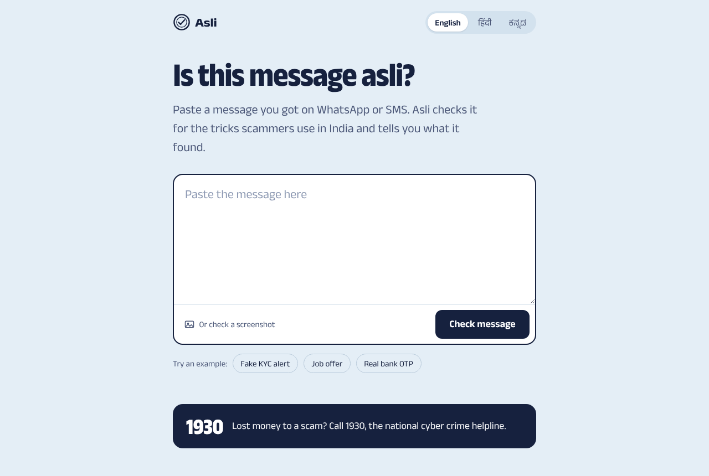
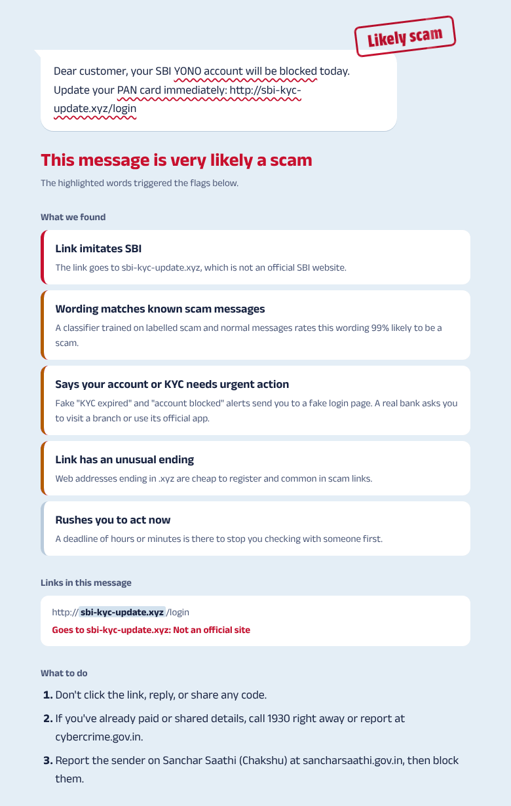
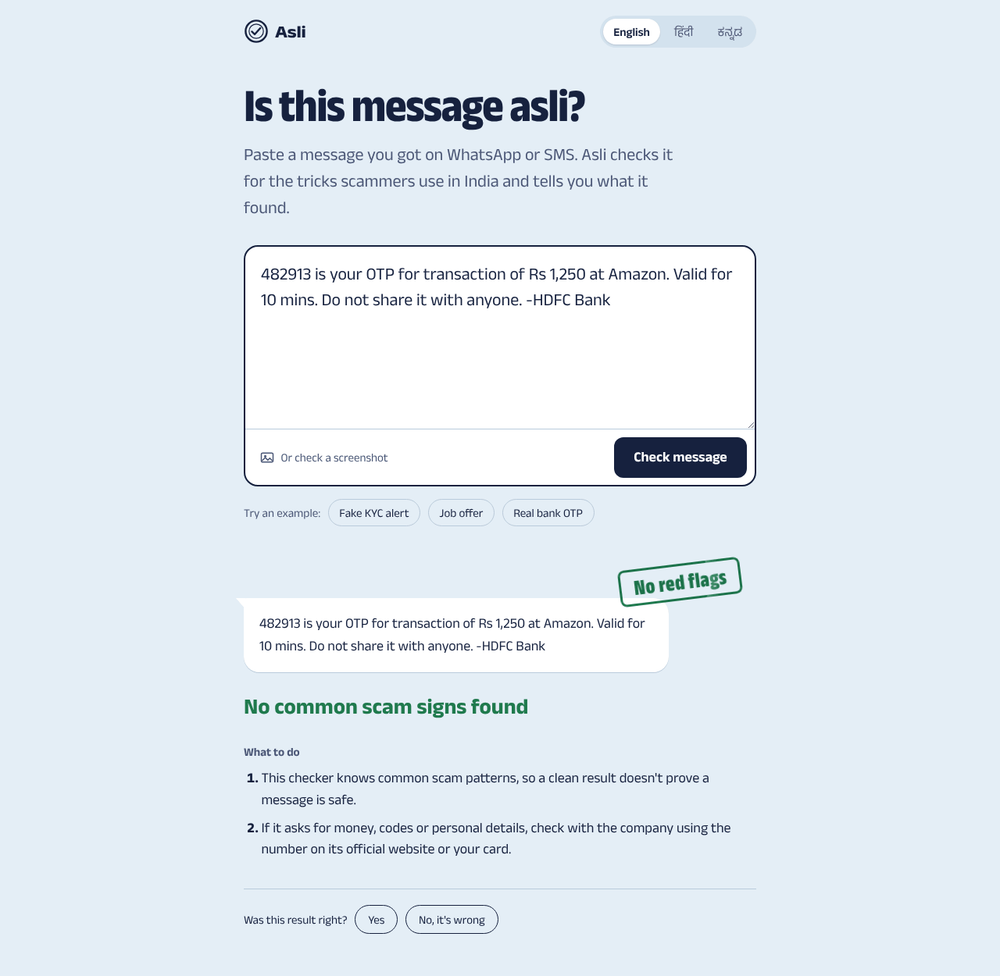
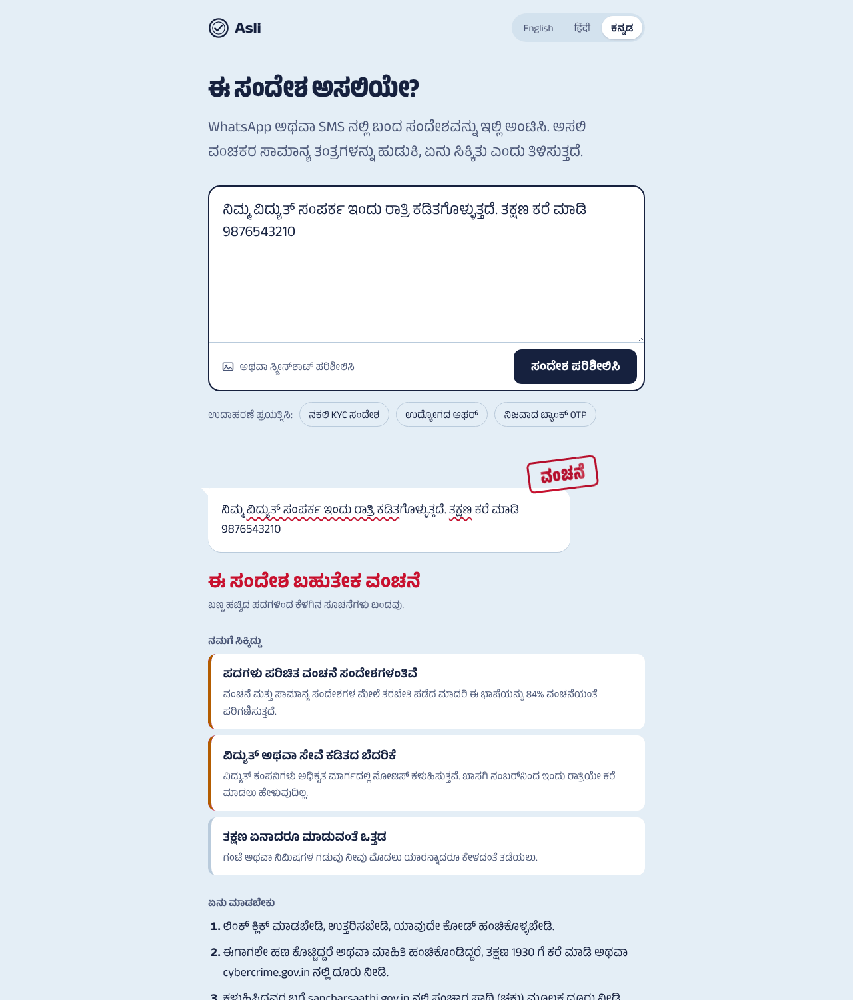
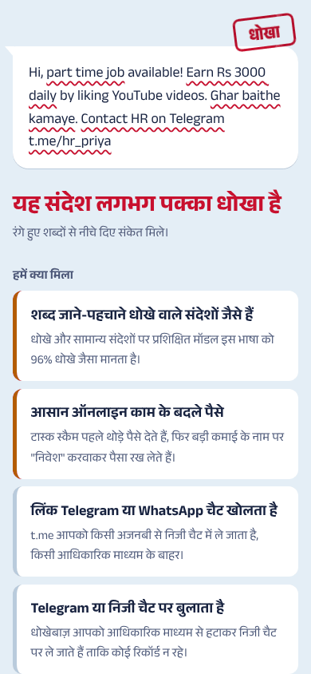

# Asli

Asli checks a WhatsApp or SMS message for the tricks scammers use in India and tells you, in English, Hindi or Kannada, what it found and what to do next.

Fake KYC alerts, "share your OTP" calls, UPI refund tricks, part-time job scams, fake courier holds and "digital arrest" threats reach people every day. Older family members get hit hardest, and often in Hinglish or a regional language. Asli gives them a second opinion they can read.

## How it works

Paste a message, upload a screenshot, or forward it on WhatsApp once you connect the Cloud API. The page works in English, हिंदी and ಕನ್ನಡ.



The message comes back as a chat bubble with the risky words underlined and a verdict stamped on the corner. Under it you get each red flag in plain words, every link with its real domain picked out, and what to do: don't click, call 1930 if you've already paid, and report the sender on Sanchar Saathi.



A normal bank OTP message passes. Asli still reminds you that a clean result is not a guarantee.



The page and the explanations switch language with the toggle at the top. Asli also detects the message's script, so a WhatsApp reply comes back in the language the message was written in.





## How Asli decides

Three checks run on every message, and the verdict combines them.

1. **Rules** in English, Hinglish, Hindi and Kannada look for known tricks: asking for an OTP or PIN, "enter your PIN to receive money", remote access apps, arrest threats, KYC and account-block alerts, prizes, task jobs, parcel holds, power cut threats, guaranteed returns, fees and moves to Telegram. Each rule has a weight. A rule ignores negated phrases like "do not share your OTP" and legitimate hand-offs like giving a ride OTP to the driver.
2. **Link checks** find the domain each link really goes to. They flag look-alikes of two dozen banks, wallets, couriers and government sites (`hdfc-netbanking.top`), brand names hidden in subdomains (`onlinesbi.sbi.secure-login.co`), shorteners, bare IP addresses, punycode, `.apk` downloads and cheap TLDs. Official domains and `gov.in` sites count as safe.
3. **A classifier** scores the wording: character n-gram TF-IDF with logistic regression. Character n-grams handle Hinglish spellings and all three scripts without a separate tokenizer for each.

The score is a noisy-OR of the rule and link weights plus the classifier's probability, so two medium signals add up to more than either alone. Asli calls a message a scam at 0.75 and suspicious at 0.4.

## Results

On 91 hand-written messages (47 scams, 44 normal) in `data/eval.csv`:

| System | Precision | Recall | F1 | False positive rate |
|---|---|---|---|---|
| Rules and links only | 1.000 | 0.702 | 0.825 | 0.000 |
| Classifier only | 0.957 | 0.936 | 0.946 | 0.045 |
| Combined | 0.979 | 0.979 | 0.979 | 0.023 |

The rules never raise a false alarm but miss scams that use new wording. The classifier catches most of those but flags some short normal messages. Combined, Asli catches 46 of 47 scams and wrongly flags 1 of 44 normal messages.

Read these numbers with three caveats:

- The classifier trains on 3,000 synthetic messages generated from templates (`scripts/make_training_data.py`). Real scam data in Indian languages is scarce and full of personal details.
- I wrote the eval set myself, in different phrasing from the templates. I also looked at its mistakes while improving the rules, so treat the scores as optimistic until the app has real labelled feedback.
- The eval set has only 9 to 10 messages each in Hindi, Hinglish and Kannada.

Known misses: a Hindi message asking for "कोड" rather than "OTP", and an ICICI video KYC reminder that the classifier finds too similar to fake KYC alerts.

CI runs `scripts/evaluate.py` on every push and fails the build if recall drops below 0.90 or the false positive rate rises above 0.10.

## Learning from feedback

After each check, the page asks "Was this result right?". Asli stores the answer next to a redacted copy of the message. `scripts/retrain_with_feedback.py` adds those labelled messages to the training set, retrains, and runs the eval. It keeps the new model only if the eval still passes.

## Privacy

- Before saving a check, Asli replaces phone numbers, account and card numbers, OTPs, emails and UPI IDs with placeholders and strips query strings from links. It keeps the wording and the link domains, since those are what retraining needs.
- Screenshots get read in memory and never saved.
- Rate limiting uses a salted hash of the IP address or WhatsApp number, and neither gets stored.
- Set `STORE_CHECKS=0` to keep nothing at all.

## Run it locally

```bash
python -m venv .venv
source .venv/bin/activate              # Windows: .venv\Scripts\activate
pip install -r requirements-dev.txt

uvicorn app.main:app --reload          # http://localhost:8000
pytest                                 # 28 tests
python scripts/evaluate.py             # detection metrics
```

Screenshot checks need Tesseract with the Hindi and Kannada language packs (`apt install tesseract-ocr tesseract-ocr-hin tesseract-ocr-kan`). Without Tesseract, the upload option disappears and everything else still works.

With Docker and Postgres:

```bash
cp .env.example .env
docker compose up --build
```

To rebuild the model from scratch:

```bash
python scripts/make_training_data.py --n 3000
python scripts/train.py
python scripts/evaluate.py
```

## API

FastAPI serves interactive docs at `/api/docs`.

```bash
curl -X POST localhost:8000/api/check \
  -H 'content-type: application/json' \
  -d '{"text": "Your SBI account will be blocked. Update KYC at sbi-kyc.xyz", "lang": "en"}'
```

The response holds the verdict, score, each flag with its explanation and character spans, every link with its real domain, the steps to take, and a `check_id` you can send to `/api/feedback`. `/api/check-image` takes a screenshot as multipart form data.

## Connect WhatsApp

1. Create an app at developers.facebook.com, add the WhatsApp product, and note the phone number ID and a permanent access token.
2. Set `WHATSAPP_TOKEN`, `WHATSAPP_PHONE_NUMBER_ID`, `WHATSAPP_APP_SECRET` and a `WHATSAPP_VERIFY_TOKEN` of your choice.
3. In the app's WhatsApp settings, set the callback URL to `https://your-domain/webhooks/whatsapp`, use the same verify token, and subscribe to the `messages` field.
4. Set `WHATSAPP_DISPLAY_NUMBER` so the web page can show people where to forward messages.

Asli rejects any webhook call without a valid `X-Hub-Signature-256` signature. It answers Meta right away and checks the message in the background, then replies to the original message with the verdict, the top four flags and the steps to take. Forwarded screenshots go through the same OCR as uploads.

## Deploy

`render.yaml` creates a Docker web service and a Postgres database on Render. Add the WhatsApp variables in the dashboard if you want WhatsApp.

## Project layout

```
app/
  main.py              FastAPI app: pages, API, WhatsApp webhook
  analysis/
    engine.py          Combines rules, links and the classifier into a verdict
    signals.py         Multilingual red-flag rules
    urls.py            Link extraction, real domains, look-alike detection
    model.py           Classifier loading and text preparation
    normalize.py       Invisible-character clean-up, script detection
    redact.py          Personal data removal before storage
  i18n.py              Every user-facing string in English, Hindi and Kannada
  db.py                Checks and feedback (SQLAlchemy; SQLite or Postgres)
  whatsapp.py          Signature check, payload parsing, replies
  ocr.py               Tesseract screenshot reading
  ratelimit.py         Sliding-window limiter
  templates/, static/  Web page, CSS, JS, self hosted Anek fonts
data/
  train.csv            Synthetic training set
  eval.csv             Hand-written eval set
models/classifier.joblib
scripts/               Data generation, training, eval, retraining from feedback
tests/                 Engine, API and WhatsApp tests
```

## Design notes

The page borrows from the inland letter: pale blue paper and navy ink. The only strong colour is the verdict, stamped in red, amber or green. Every typeface comes from Anek by Ek Type, an Indian foundry, so Latin, Devanagari and Kannada share one voice. The font files ship with the app. Text is set large, the layout stays in one column, and only the stamp animates, which helps the older readers this is for.

Asli gives a second opinion. It can't promise that a message is safe. If you've lost money to a scam, call 1930, the national cyber crime helpline, or report it at cybercrime.gov.in.
